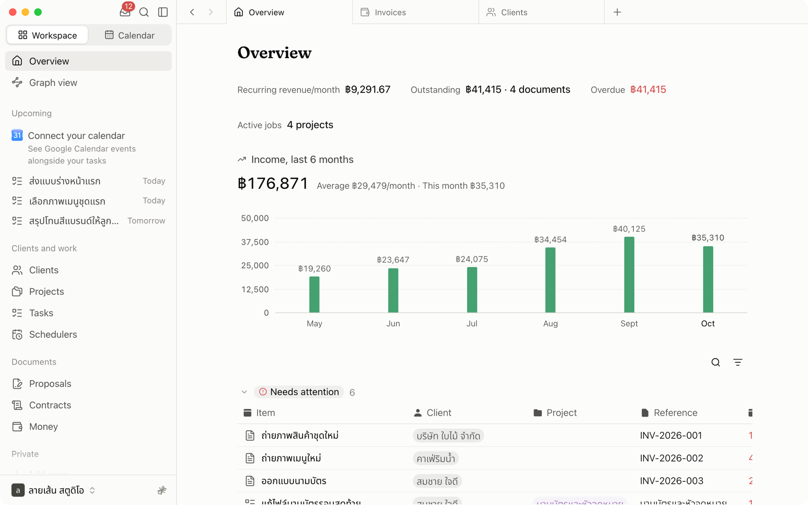

<div align="center">


# Tuhmo for macOS

**The workspace for freelancers and small teams.**<br>
Clients, projects, tasks, documents and invoices, connected in one app.

[](https://tuhmo.com/download)
[](#requirements)
[](#requirements)

[Website](https://tuhmo.com) · [Download](https://tuhmo.com/download) · [Open in browser](https://app.tuhmo.com) · [Support](mailto:support@tuhmo.com)

</div>

<br>

<p align="center">
  
</p>

## Install

```sh
brew install --cask maketuhmo/tap/tuhmo
```

That's it. Homebrew adds this tap for you the first time. To add it on its own:

```sh
brew tap maketuhmo/tap
brew install --cask tuhmo
```

## Update

Tuhmo updates itself in the background, so you always get the latest version without doing anything.

To update through Homebrew instead:

```sh
brew update
brew upgrade --cask --greedy tuhmo
```

`--greedy` is needed because the app manages its own updates.

## Uninstall

```sh
brew uninstall --cask tuhmo
```

To also remove local app data, caches and preferences:

```sh
brew uninstall --cask --zap tuhmo
```

Your workspace lives in your Tuhmo account, so nothing in it is lost when you remove the app.

## Requirements

| | |
|---|---|
| macOS | 13 Ventura or later |
| Chip | Apple silicon and Intel (universal build) |
| Account | A free Tuhmo account. Sign up at [tuhmo.com](https://tuhmo.com) |

## Security

Every release is signed with Tuhmo's Apple Developer ID and notarized by Apple. The cask downloads the same installer as [tuhmo.com/download](https://tuhmo.com/download) from `download.tuhmo.com`, and Homebrew checks it against the SHA-256 in [`Casks/tuhmo.rb`](Casks/tuhmo.rb) before installing.

## Troubleshooting

**"It seems there is already an App at /Applications/Tuhmo.app"**<br>
You installed Tuhmo from the website before. Let Homebrew take it over:

```sh
brew install --cask --adopt maketuhmo/tap/tuhmo
```

**Homebrew installs an older version**<br>
Refresh the tap, then try again:

```sh
brew update
```

## Other platforms

- **Windows:** download the installer from [tuhmo.com/download](https://tuhmo.com/download)
- **Web:** use Tuhmo in any browser at [app.tuhmo.com](https://app.tuhmo.com)

## Support

Questions or problems with the app: [support@tuhmo.com](mailto:support@tuhmo.com)<br>
Problems with this tap: [open an issue](https://github.com/maketuhmo/homebrew-tap/issues)
